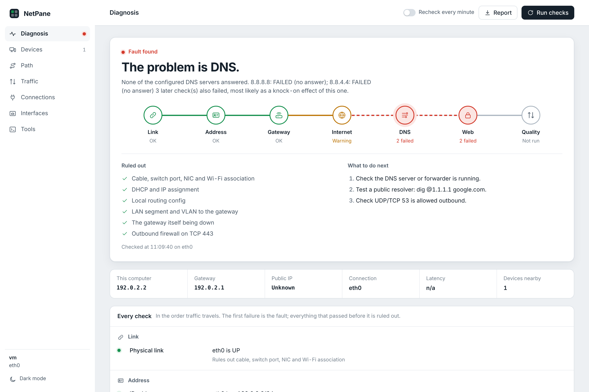
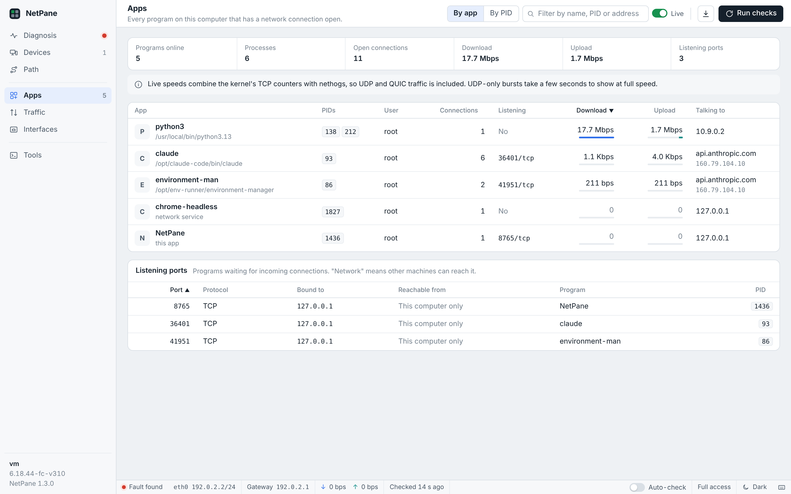
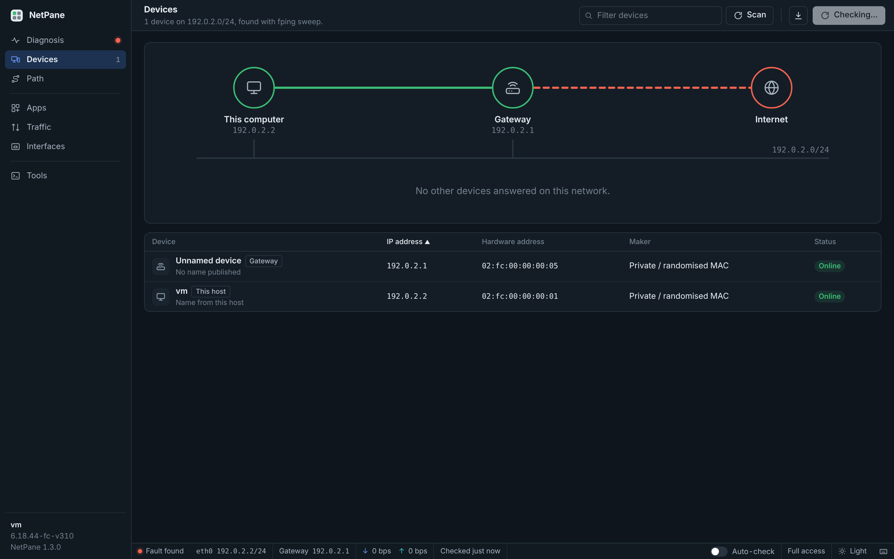

# NetPane

NetPane runs the usual network troubleshooting tools for you, all at once, and tells you in one sentence where the problem is. It works on Linux and Windows.



When someone says "the internet is down", the fault could be in a dozen places: the cable, the Wi-Fi, DHCP, the gateway, the ISP, DNS, a proxy. Checking each one by hand means running `ip`, `ping`, `arping`, `dig`, `mtr` and friends one after another and reading the output yourself. NetPane runs those checks in the order traffic actually travels, from your network card out to the web. The first check that fails is the fault, and every check that passed before it is ruled out.

It is one Python file. On Linux it needs only the standard library, so there is nothing to `pip install`. On Windows it comes as a single `NetPane.exe`. Either way it doesn't load anything from the internet, so it still works when the network is the thing that's broken.

## Quick start on Windows

1. Download `NetPane.exe` from the [latest release](https://github.com/shanesenbradz/netpane/releases/latest).
2. Double-click it. A small console window opens and your browser goes to `http://127.0.0.1:8765`.
3. Close that console window when you're done.

For the full picture (every program name on the Apps page), right-click `NetPane.exe` and choose **Run as administrator**.

Windows SmartScreen may warn you the first time, because the exe isn't code-signed. Click **More info**, then **Run anyway**. If you'd rather not trust a downloaded exe, run the same file with Python instead: `pip install psutil`, then `python netpane.py`.

On Windows, NetPane uses the tools that come with Windows (`ping`, `tracert`, `pathping`, `ipconfig`, `netsh`, `arp`, `route`, `netstat`, `nslookup`) plus PowerShell, so there's nothing else to install. If you also have Nmap or Wireshark, it picks them up for faster device scans and packet capture.

## Quick start on Linux

```bash
curl -LO https://raw.githubusercontent.com/shanesenbradz/netpane/main/netpane.py
sudo python3 netpane.py
```

NetPane opens in its own window, without tabs or an address bar, if you have Brave, Chrome, Chromium, Edge or Vivaldi. Otherwise it opens a normal browser tab. Closing the window stops NetPane. Press **Run checks** (or Ctrl+R) any time to test again.

Running with `sudo` is optional. Without it you still get most of the picture, but layer 2 checks (`arping`), packet capture, system services on the Apps page, and live speeds that include UDP need root.

To add NetPane to your applications menu, run this once (without sudo):

```bash
python3 netpane.py --install
```

It then shows up like any other app. Right-click it and choose **Run with full access** to start it as root through your desktop's normal password prompt. `--uninstall` removes it again.

No browser on the box (a server over SSH)? Print the full report to the terminal instead:

```bash
sudo python3 netpane.py --report
```

## What it checks

| Stage | Checks | If it passes, you can stop worrying about |
|---|---|---|
| Link | Carrier, speed, duplex, interface errors, Wi-Fi signal | The cable, switch port, NIC and Wi-Fi association |
| Address | IPv4 address (catches 169.254 self-assigned), default route | DHCP and local routing |
| Gateway | ARP reply and ping from the gateway | The VLAN, the LAN segment and the gateway itself |
| Internet | Ping and TCP 443 to 1.1.1.1 and 8.8.8.8, path MTU | The router's WAN side, the ISP and outbound firewall rules |
| DNS | Every configured DNS server on its own, then system name lookups | Each resolver, separately |
| Web | HTTPS request, captive portal and transparent proxy detection | TLS, proxies and hotel-style login pages |
| Quality | Loss, latency and jitter over 10 pings | A slow or flaky line |

Some judgement is built in so you don't chase false alarms. A gateway that ignores ping but answers ARP is a warning, not a failure, because plenty of firewalls do that. A path MTU below 1500 only gets flagged when packets are being dropped silently (an MTU black hole), not when routers report the limit properly.

## Everything else on screen

- **Devices**: sweeps your subnet and lists every device with its name (from DNS, mDNS or NetBIOS), MAC address and maker. Click one to ping it, scan its ports, trace the route to it, or open an SSH login. SSH opens your own terminal with `ssh user@host` ready, so you type the password there. NetPane never sees it.
- **Path**: hop-by-hop trace with loss and latency per router, and it points at the hop where loss starts and carries through to the end.
- **Traffic**: live download and upload graph per interface, plus `vnstat` history if you have it.
- **Apps**: every program on this computer with a network connection open, with its PIDs, user, connection count, listening ports, live download and upload speed, and the server it's talking to most. Switch between one row per app (Brave's many processes grouped together) and one row per PID. Click a program to see every connection it holds, with the remote server's name. Right-click to copy PIDs.
- **Interfaces**: addresses, speeds, error counters, routing table, DNS settings, Wi-Fi and nearby networks. The VLAN card shows any 802.1Q tag this host carries, and whether the segment reaches the gateway and the internet. On an access port the switch strips the tag, so press **Listen for a switch** to learn the port or native VLAN from an LLDP or CDP advertisement (needs root, or lldpd installed).
- **Tools**: a console for all 30 underlying tools with example commands. It adds safe limits automatically (packet counts, report mode, time limits) so nothing runs forever.
- **Lookups**: passive, read-only intel on a domain, IP or host. DNS records with SPF and DMARC posture, WHOIS and RDAP, a TLS certificate inspector with expiry, ASN and BGP origin, and a public-exposure check (open ports and known CVEs) via Shodan's keyless InternetDB. Everything is a normal public query and nothing here touches the target beyond that.
- **Report**: downloads a plain-text report you can paste into a ticket or send to your ISP.



### How the Apps speeds work

For TCP, NetPane reads the kernel's own byte counters for each connection (`ss -i`) and works out the speed from how fast they grow. That's exact, needs no root, and costs almost nothing. Browsers send a good share of traffic (YouTube, Google services) over QUIC, which is UDP, and the kernel doesn't keep those counters for UDP. So when `nethogs` is installed and NetPane runs as root, it also runs `nethogs` in the background and uses whichever figure is higher for each program. That picks up the UDP traffic. On Windows, the Apps page shows PIDs and connections, but not live speeds yet.

## Keyboard shortcuts

| Keys | Does |
|---|---|
| Ctrl+R or F5 | Run all checks again |
| Ctrl+1 to Ctrl+8 | Switch page |
| `/` or Ctrl+F | Jump to the page's filter or search box |
| Up and Down | Move through table rows |
| Enter | Open the selected row |
| Shift+F10 or right-click | Row menu: copy PID, copy IP, ping, scan, trace |
| Ctrl+S | Save the text report |
| Esc | Close panels and menus |
| `?` | Show these shortcuts |



## Requirements

- **Windows:** Windows 10 or 11. The exe has everything built in.
- **Linux:** Python 3.8 or newer, plus `iproute2` and `iputils-ping`, which almost every distro ships by default.

On Linux, everything else is optional. NetPane uses each tool when it finds it and quietly skips it when it doesn't. The Tools page lists what's missing and gives you the exact install command. On Debian or Ubuntu, this covers the lot:

```bash
sudo apt install -y fping mtr-tiny traceroute dnsutils nmap ethtool arping iw \
  network-manager tcpdump tshark ngrep iperf3 iftop nethogs vnstat whois lsof \
  netcat-openbsd net-tools pciutils lshw avahi-utils samba-common-bin lldpd
```

## Options

```
sudo python3 netpane.py [--port 8765] [--bind 127.0.0.1] [--no-browser] [--tab] [--keep-running] [--report]
python3 netpane.py --install | --uninstall
NetPane.exe [--port 8765] [--bind 127.0.0.1] [--no-browser] [--report]
```

| Option | What it does |
|---|---|
| `--port` | Port for the dashboard (default 8765) |
| `--bind` | Address to listen on. Defaults to `127.0.0.1`, so only this machine can open it |
| `--no-browser` | Don't open a window on start (for servers and SSH tunnels). NetPane keeps running until Ctrl+C |
| `--tab` | Open in a normal browser tab instead of its own window |
| `--keep-running` | Keep running after the NetPane window is closed |
| `--report` | Run every check, print the text report (including every program on the network and its PID) and exit |
| `--install`, `--uninstall` | Add or remove NetPane in your Linux applications menu |
| `--version` | Print the version |

## Security

NetPane can run network tools as root, so by default it only listens on `127.0.0.1`. It refuses requests whose `Host` header doesn't match, which blocks DNS rebinding, and it refuses cross-origin POSTs. The console only runs the tools in its list, passes arguments without a shell, and adds time and packet limits.

If you start it with `--bind 0.0.0.0` so you can open it from another machine, anyone who can reach that port can run those tools on your box. Only do that on a network you trust. A safer way to view it remotely is an SSH tunnel:

```bash
ssh -L 8765:127.0.0.1:8765 you@server
```

then open `http://127.0.0.1:8765` on your own machine.

## Known limits

- macOS isn't supported yet.
- On Windows, Wi-Fi details come from `netsh`, which prints its labels in the system language. On a non-English Windows the Wi-Fi panel may show less detail. Everything else works the same in any language.
- Windows 11 24H2 and later only lists nearby Wi-Fi networks if location services are on for desktop apps.
- The device sweep covers your primary interface's subnet, capped at a /24 on bigger networks so it finishes in reasonable time.
- Device type guesses come from the MAC maker and open ports. They're a hint, not an inventory.
- The internet checks use Cloudflare (1.1.1.1), Google (8.8.8.8) and Google's connectivity check URL. Networks that block those will show as failing even if other sites work.

## Building the Windows exe yourself

Every push to this repo builds `NetPane.exe` on a Windows machine through GitHub Actions and runs it through a test of every page (see `packaging/smoke_test.py`). The exe is attached to each run, and to the release when a version tag is pushed. To build it on your own Windows PC:

```
pip install pyinstaller psutil
pyinstaller --onefile --console --name NetPane --icon packaging/netpane.ico --version-file packaging/version.txt netpane.py
```

The exe lands in `dist\NetPane.exe`.

## Licence

MIT. See [LICENSE](LICENSE).
